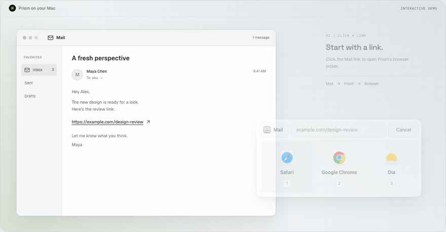
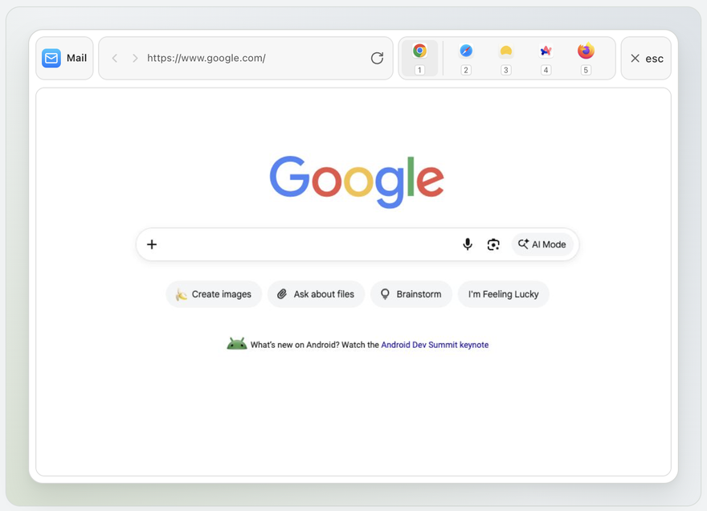
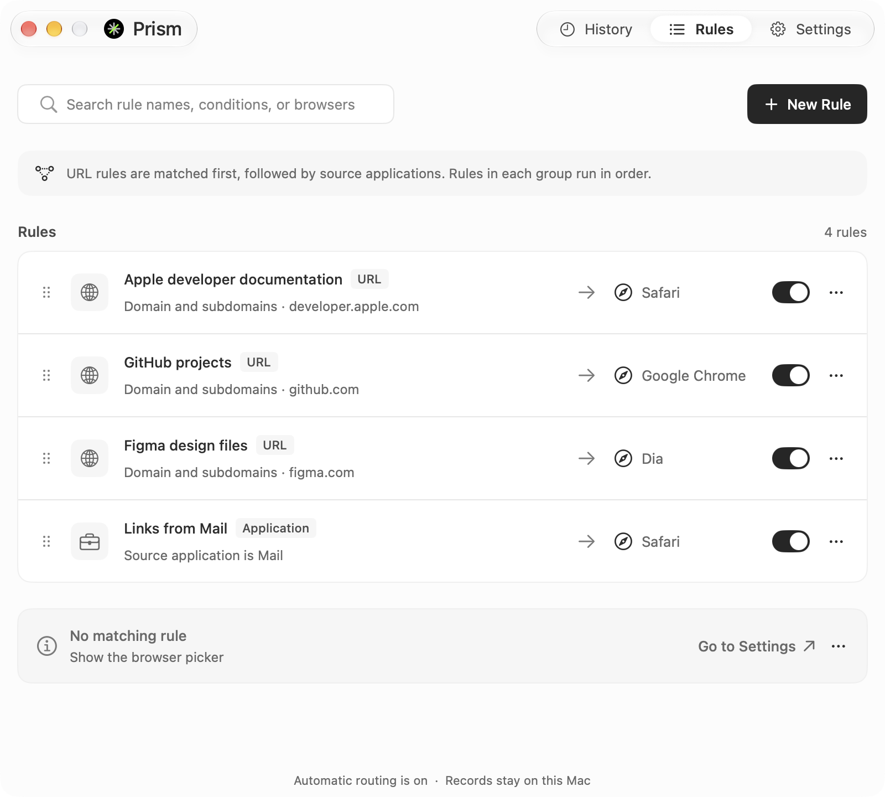
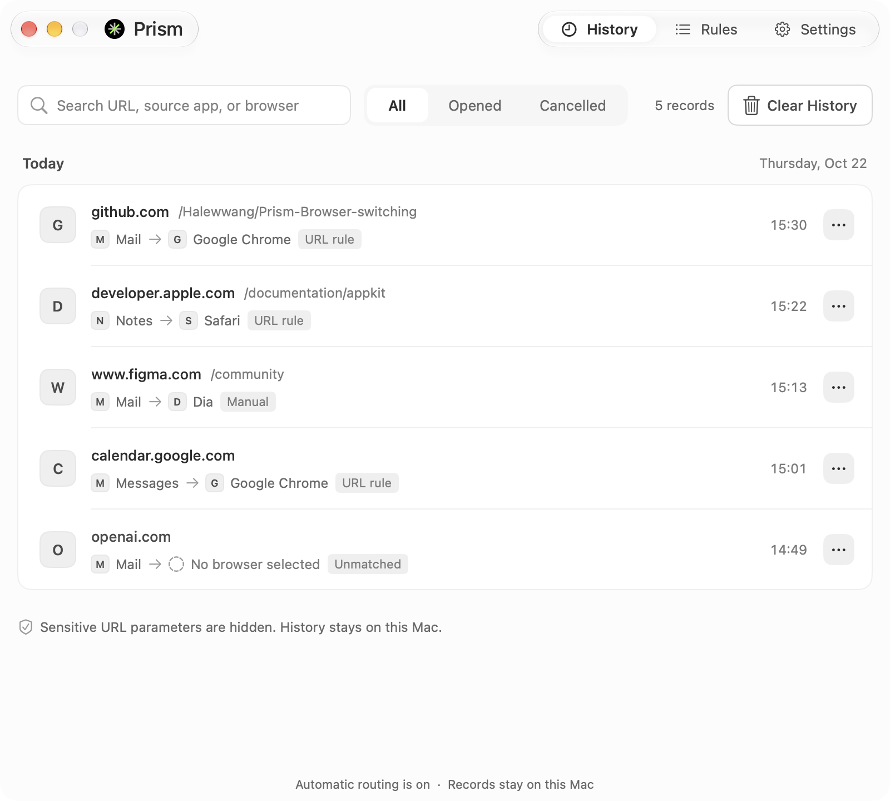
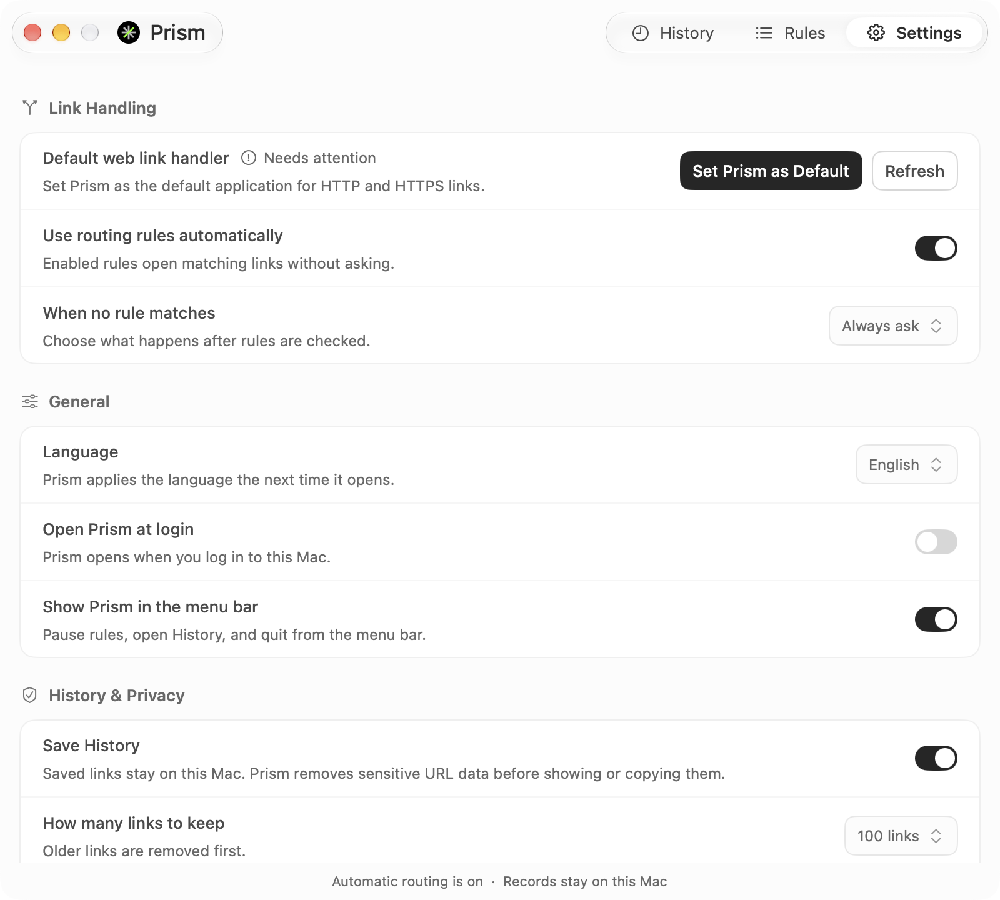

# Prism

[简体中文](README.md) · English

  <picture>
    <source media="(prefers-color-scheme: dark)" srcset="assets/brand/sources/brand-dark-128.svg" />
    
  </picture>
  <h2>Your links. In the right browser.</h2>
  
A native browser router for macOS. Open work links in your work browser, keep personal browsing separate, or preview a page before choosing its browser.

  
<strong>macOS 15+ · Apple Silicon &amp; Intel · v1.15.10 / Build 25 public test</strong>

  

    <a href="https://prismmac.vercel.app/">Website</a> ·
    <a href="https://github.com/Halewwang/Prism/releases/download/v1.15.10/Prism-1.15.10-universal-test.dmg">Download for macOS</a> ·
    <a href="https://github.com/Halewwang/Prism/releases/tag/v1.15.10">Release notes</a>
  

## See Prism in action

Click a link in Mail, pick a browser in Prism, and open the same page. The animation below shows the simulated flow from the Prism website.

Use Link Preview to look through a page before opening it in Safari, Chrome, or another browser.

Try both modes on the website by switching between **Link preview** and **Browser picker**. [Open the Prism website](https://prismmac.vercel.app/)

View screenshots of Rules, History, and Settings

| History | Settings |
| --- | --- |
|  |  |

Screenshots show v1.14.9 with sample data.

## A browser for every link

Set Prism as your default browser. When you open an HTTP or HTTPS link from another app, Prism checks your rules and sends it to the right browser. If nothing matches, your chosen fallback takes over.

- **Route by URL.** Match an exact domain, a domain and its subdomains, or text contained in a URL.
- **Route by source app.** Give links from a confirmed source application their own browser. URL rules take priority; source detection varies by app.
- **Preview before opening.** Browse and interact with a page in a floating preview, then hand it off to your chosen browser. Switch back to the classic browser picker in Settings at any time.
- **Choose in a moment.** Click a browser or use number keys, arrows, and Return. Narrow preview windows use an icon-and-number menu with up/down selection; Escape closes the preview.
- **Make room for the page.** Move and resize the preview, and choose whether it reopens where you last closed it. Zoom with pinch gestures or ⌘+ / ⌘− / ⌘0.
- **Keep a useful fallback.** Show the picker, use your preferred browser, or reuse the last browser that successfully opened a link. The picker puts recently used browsers first.
- **Find links again.** Search and filter local history, review how a link was handled, and jump to rules to correct future routing. Preview a rule without opening a browser.
- **Keep routing local.** Rules, settings, and link history stay on your Mac. Update checks contact GitHub and can be turned off.

## Recent public test updates

- **v1.15.7** — With Link Preview enabled, go to **Settings → Link Handling → Preview window position**. Choose whether the preview follows the mouse (the default) or remembers where you last closed it, even after a restart. [Release notes](https://github.com/Halewwang/Prism/releases/tag/v1.15.7)
- **v1.15.6** — Choose **Open With → Prism** in Finder to pick a browser for a local `.html` or `.htm` file. [Release notes](https://github.com/Halewwang/Prism/releases/tag/v1.15.6)
- **v1.15.5** — Give browsers and Chromium profiles custom display names, use checkboxes to choose which browsers appear in the picker, and hide the Dock icon when all regular windows are closed. [Release notes](https://github.com/Halewwang/Prism/releases/tag/v1.15.5)
- **v1.15.4** — Import and export rules as JSON, clear Link Preview website data, and filter History for links that failed to open. [Release notes](https://github.com/Halewwang/Prism/releases/tag/v1.15.4)

## Get started

1. Download [Prism-1.15.10-universal-test.dmg](https://github.com/Halewwang/Prism/releases/download/v1.15.10/Prism-1.15.10-universal-test.dmg), open it, and drag Prism into Applications.
2. Open Prism and follow setup to make it your default browser. You can also select it in **System Settings → Desktop & Dock → Default web browser**.
3. Choose your fallback behavior. For manual browser choices, select Link Preview or Browser Picker in Settings, then add URL or source-app rules.
4. Open a link from an app you use and check where it goes.

This public test uses ad hoc signing and is not Apple-notarized. First launch may require manual approval in macOS. The download is a Universal build for Apple Silicon and Intel Macs. [Installation instructions and public-test limitations](docs/public-test-release-1.15.10.md)

v1.15.10 fixes a duplicate outer focus ring on the **Selection window** wireframe cards so clicking an option always shows a single clean 1pt border.

v1.15.9 lightens the Selection window card border to a crisp 1pt stroke, shortens Simplified Chinese history-limit options, and enlarges the menu bar icon glyph from 12.65pt to 15pt inside its 18pt canvas to match neighboring macOS menu bar icons.

v1.15.8 replaces the **Settings → Link Handling → Selection window** dropdown with visual wireframe cards for **Browser selector** and **Link preview**, adapting to light/dark appearances, high contrast, and keyboard navigation.

Native v1.14.11 and later can check for updates in Settings or the menu bar menu. If you’re on v1.14.10 or earlier, install manually once to switch to the new update feed. Your local rules, settings, and history stay in place.

Link preview uses macOS WebKit and its own sign-in session; it does not inherit logins from external browsers. Website compatibility depends on the site and macOS version; open the page in your browser if its sign-in or features are unsupported. Source detection varies by app. Regex rules are not supported; Chrome / Edge profile routing is experimental.

## A few useful examples

| You want to… | Create this rule |
| --- | --- |
| Open GitHub links in your work browser | Domain and subdomains `github.com` → Chrome |
| Keep a specific site in Safari | Exact domain `example.com` → Safari |
| Open local development links in a testing browser | URL contains `localhost:3000` → your development browser |
| Separate links from a work app | Source app → your work browser, when macOS confirms the sender |

## Feedback and development

Report bugs or suggest improvements in [Issues](https://github.com/Halewwang/Prism/issues). Include your Prism and macOS versions plus steps to reproduce; remove private links from shared screenshots or logs.

For native builds, see the [build and release guide](native/docs/signing-and-release.md). The [website source](website/) is included in this repository.

## Open-source license

Prism’s source code is publicly available. The project does not currently have a published open-source license. Third-party dependencies are covered by their own licenses.
