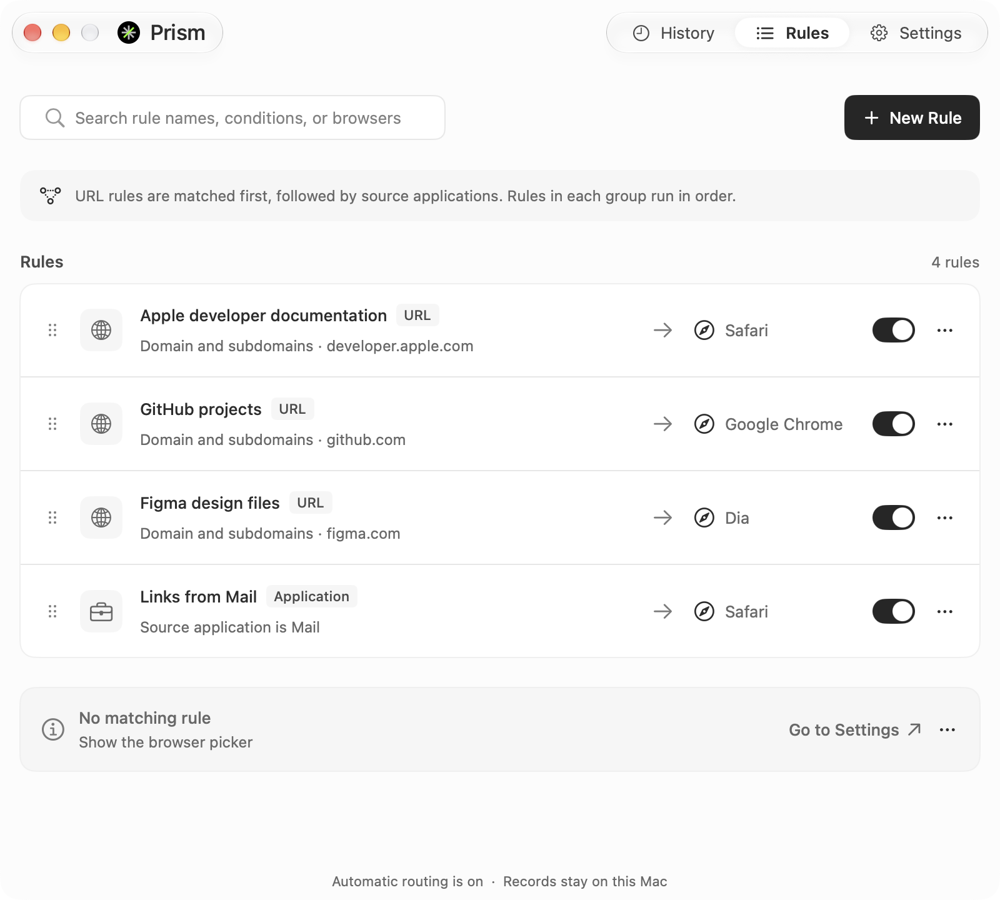
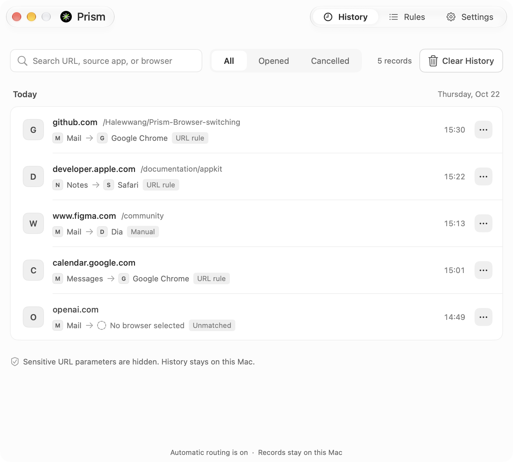
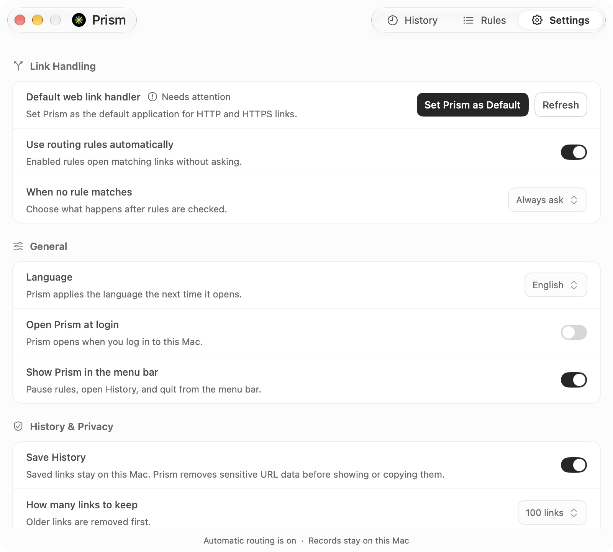
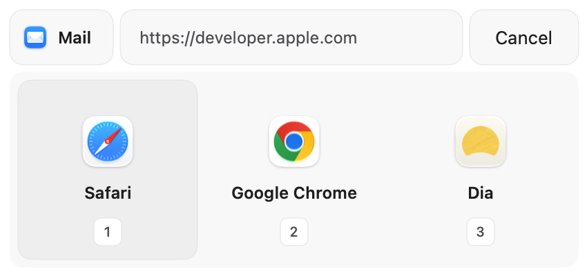

# Prism

[简体中文](README.md) · English

  <picture>
    <source media="(prefers-color-scheme: dark)" srcset="assets/brand/sources/brand-dark-128.svg" />
    
  </picture>
  <h2>Your links. In the right browser.</h2>
  
A native browser router for macOS. Open work links in your work browser, keep personal browsing separate, and choose a browser when you need to.

  
<strong>macOS 15+ · Apple Silicon &amp; Intel · v1.14.12 / Build 13 public test</strong>

  

    <a href="https://prismmac.vercel.app/">Website</a> ·
    <a href="https://github.com/Halewwang/Prism/releases/download/v1.14.12/Prism-1.14.12-universal-test.dmg">Download for macOS</a> ·
    <a href="https://github.com/Halewwang/Prism/releases/tag/v1.14.12">Release notes</a>
  

## A browser for every link

Set Prism as your default browser. When you open an HTTP or HTTPS link from another app, Prism checks your rules and sends it to the right browser. If nothing matches, your chosen fallback takes over.

- **Route by URL.** Match an exact domain, a domain and its subdomains, or text contained in a URL.
- **Route by source app.** Give links from a confirmed source application their own browser. URL rules take priority; source detection varies by app.
- **Choose in a moment.** The compact browser picker appears near your pointer, with number keys, arrow keys, Return, and Escape support.
- **Keep a useful fallback.** Show the picker, use your preferred browser, or reuse the last browser that successfully opened a link. The picker puts recently used browsers first.
- **Find links again.** Search and filter local history, review how a link was handled, and jump to rules to correct future routing. Preview a rule without opening a browser.
- **Keep routing local.** Rules, settings, and link history stay on your Mac. Update checks contact GitHub and can be turned off.

## See Prism in action

### Rules

Manage URL and source-app rules together, choose their destination browsers, and adjust priority or pause individual rules.

| History | Settings |
| --- | --- |
|  |  |
| Find previous links and review their routing results. | Adjust browser choices, automatic routing, and history retention. |

### Browser picker

Choose directly when a link needs a different browser.

<small>Screenshots show v1.14.9 with sample data. They do not show the window entrance motion, history filters, or menu styling changes in v1.14.12.</small>

## Get started

1. Download [Prism-1.14.12-universal-test.dmg](https://github.com/Halewwang/Prism/releases/download/v1.14.12/Prism-1.14.12-universal-test.dmg), open it, and drag Prism into Applications.
2. Open Prism and follow setup to make it your default browser. You can also select it in **System Settings → Desktop & Dock → Default web browser**.
3. Choose your fallback browser behavior, then add a URL or source-app rule.
4. Open a link from an app you use and check where it goes.

This public test uses ad hoc signing and is not Apple-notarized. First launch may require manual approval in macOS; see the [installation instructions and public-test limitations](docs/public-test-release-1.14.12.md). The download is a Universal build for Apple Silicon and Intel Macs.

v1.14.12 refines window entrance motion, history result filters, and menu focus styling. Users on v1.14.11 can check for updates and install in the app.

Source detection varies by app. Regex rules are not supported; Chrome / Edge profile routing is experimental.

## A few useful examples

| You want to… | Create this rule |
| --- | --- |
| Open GitHub links in your work browser | Domain and subdomains `github.com` → Chrome |
| Keep a specific site in Safari | Exact domain `example.com` → Safari |
| Open local development links in a testing browser | URL contains `localhost:3000` → your development browser |
| Separate links from a work app | Source app → your work browser, when macOS confirms the sender |

Upgrading from v1.14.10 or earlier? Download and install this version manually once after the repository rename. Future updates use the new repository. Your local rules, settings, and history stay in place.

## Feedback and development

Report bugs or suggest improvements in [Issues](https://github.com/Halewwang/Prism/issues). Include your Prism and macOS versions plus steps to reproduce; remove private links from shared screenshots or logs.

For native builds, see the [build and release guide](native/docs/signing-and-release.md). The [website source](website/) is included in this repository.
