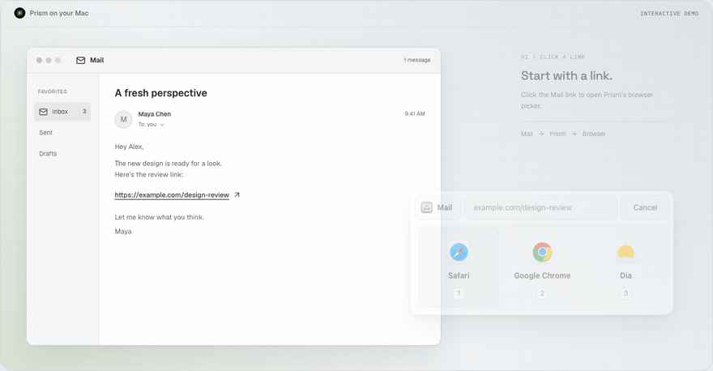
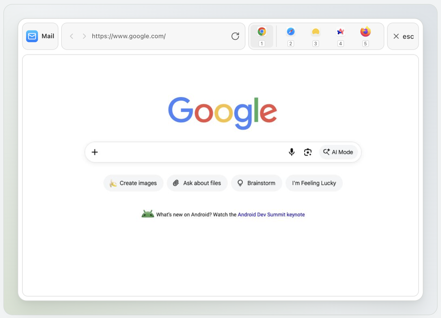
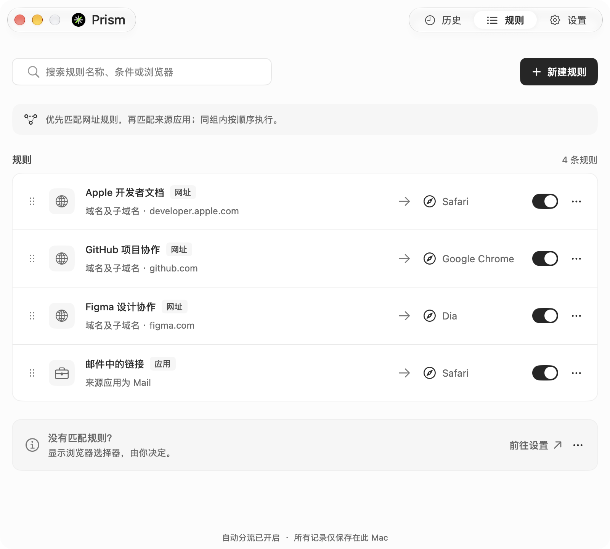

# Prism

简体中文 · [English](README.en.md)

<div align="center">
  <picture>
    <source media="(prefers-color-scheme: dark)" srcset="assets/brand/sources/brand-dark-128.svg" />
    
  </picture>
  <h2>链接，自有去处</h2>
  <p>为工作链接指定浏览器，让每次打开都少一次选择。</p>
  <p>Prism 是原生 macOS 浏览器路由工具。按网址或已确认的来源应用自动分流链接，<br />没有匹配规则时，可以先预览网页，再选择浏览器继续。</p>
  <p>
    <a href="https://prismmac.vercel.app/">官网</a> ·
    <a href="https://github.com/Halewwang/Prism/releases/download/v1.15.8/Prism-1.15.8-universal-test.dmg">下载 macOS 版</a> ·
    <a href="https://github.com/Halewwang/Prism/releases/tag/v1.15.8">发布说明</a>
  </p>
  <p><small>v1.15.8 · 构建 23 · 原生公开测试版 · macOS 15+ · Apple Silicon / Intel</small></p>
</div>

## 界面演示

从邮件点开链接，Prism 弹出选择器，再用选中的浏览器打开同一网页。下方动图录自官网的模拟演示。

[](https://prismmac.vercel.app/#try-prism)

在链接预览窗里先看网页内容，再交给常用的浏览器继续。



到官网体验交互版，在浏览器选择演示区切换「Link preview」和「Browser picker」。[打开 Prism 官网](https://prismmac.vercel.app/)

<details>
<summary>查看规则、历史和设置截图</summary>



| 历史 | 设置 |
| --- | --- |
|  |  |

截图来自 v1.14.9，使用示例数据。

</details>

## 为不同链接，找到合适的浏览器

工作链接用 Chrome，个人阅读用 Safari，开发地址用专用浏览器。将 Prism 设为默认浏览器后，从其他应用打开的 HTTP / HTTPS 链接会按你的规则交给目标浏览器。

- **按网址分流**：匹配精确域名、域名及子域名，或网址中的指定文本。
- **按来源应用分流**：为不同应用指定浏览器；仅在系统已确认链接来源时执行来源规则。
- **先预览，再打开**：在浮窗中浏览和操作网页，再交给目标浏览器继续；设置中可随时切回传统浏览器选择器。
- **快速选择浏览器**：支持点击、数字键、方向键与 Return 确认。预览窄窗使用图标与数字下拉列表，上下切换目标，Esc 关闭。
- **按需调整预览**：拖动浮窗、调整尺寸，可记住上次关闭的位置。支持触控板捏合和 ⌘+ / ⌘− / ⌘0 网页缩放。
- **按习惯打开**：未匹配时，可显示选择器、使用首选浏览器，或沿用上次成功使用的浏览器。选择器也会优先显示最近使用的浏览器。
- **回看与调整**：搜索链接历史、筛选处理结果，查看命中规则并跳转调整；规则预览无需打开浏览器。
- **数据留在本机**：路由、规则和历史在此 Mac 上处理与保存。更新检查会连接 GitHub，可在设置中关闭自动检查。

## 最近公测更新

- **v1.15.7**　开启链接预览后，在「设置 → 链接处理 → 预览窗位置」选择跟随鼠标（默认），或记住上次关闭的位置。记住的位置在重启后仍然有效。[发布说明](https://github.com/Halewwang/Prism/releases/tag/v1.15.7)
- **v1.15.6**　在 Finder 中通过「打开方式 → Prism」将本地 `.html` 或 `.htm` 文件交给所选浏览器。[发布说明](https://github.com/Halewwang/Prism/releases/tag/v1.15.6)
- **v1.15.5**　为浏览器和 Chromium Profile 设置备用名称，通过勾选管理哪些浏览器显示在选择界面，并可在关闭所有常规窗口后隐藏程序坞图标。[发布说明](https://github.com/Halewwang/Prism/releases/tag/v1.15.5)
- **v1.15.4**　以 JSON 导入和导出规则，清除链接预览的网站数据，并在历史记录中筛选打开失败的链接。[发布说明](https://github.com/Halewwang/Prism/releases/tag/v1.15.4)

## 开始使用

1. 下载 [Prism for macOS](https://github.com/Halewwang/Prism/releases/download/v1.15.8/Prism-1.15.8-universal-test.dmg)，打开 DMG，将 Prism 拖入“应用程序”。更新前先退出旧版。
2. 打开 Prism，按引导将其设为默认浏览器。
3. 选择未匹配链接的打开方式；需要手动选择时，可在设置中选用“链接预览”或“浏览器选择器”。再添加常用网址或来源应用规则。
4. 从其他应用点击链接，验证分流结果。

当前为 ad hoc 签名的公开测试版，尚未完成 Developer ID 签名与 Apple 公证。首次打开、文件校验及已知限制见 [安装与公测说明](docs/public-test-release-1.15.8.md)。

v1.15.8 将「设置 → 链接处理 → 选择窗口模式」由下拉菜单升级为可视化线框选项卡片，直观展示「浏览器选择器」与「链接预览」两种窗口形态的差异，支持浅色/深色外观、高对比度与键盘方向键切换。

链接预览使用 macOS WebKit，登录会话独立，不继承外部浏览器的登录状态。网站兼容性随系统与网站而异；登录或网页功能不受支持时，可交给完整浏览器继续。来源识别因应用而异；原生版暂不支持正则规则，Chrome / Edge Profile 为实验功能。

v1.14.11 及以后的原生版可在设置或菜单栏菜单中检查更新。v1.14.10 及更早原生版需手动安装一次，以切换到新的更新地址。本机规则、设置和历史会保留。

## 开发与反馈

原生应用位于 [`native/`](native)，采用 SwiftUI、AppKit 与 SwiftData；需要 macOS 15+、支持 Swift 6 的 Xcode 和 XcodeGen 2.46.0。构建方式见 [原生开发与发布说明](native/docs/signing-and-release.md)。官网源码位于 [`website/`](website)。

```bash
git clone https://github.com/Halewwang/Prism.git
cd Prism/native
swift test
```

欢迎通过 [Issues](https://github.com/Halewwang/Prism/issues) 反馈问题，或提交 Pull Request。反馈时请附版本、macOS 版本与复现步骤，并移除私人链接。

## 开源许可证

Prism 已公开源代码，目前尚未发布项目级开源许可证。第三方依赖适用各自的许可证。
