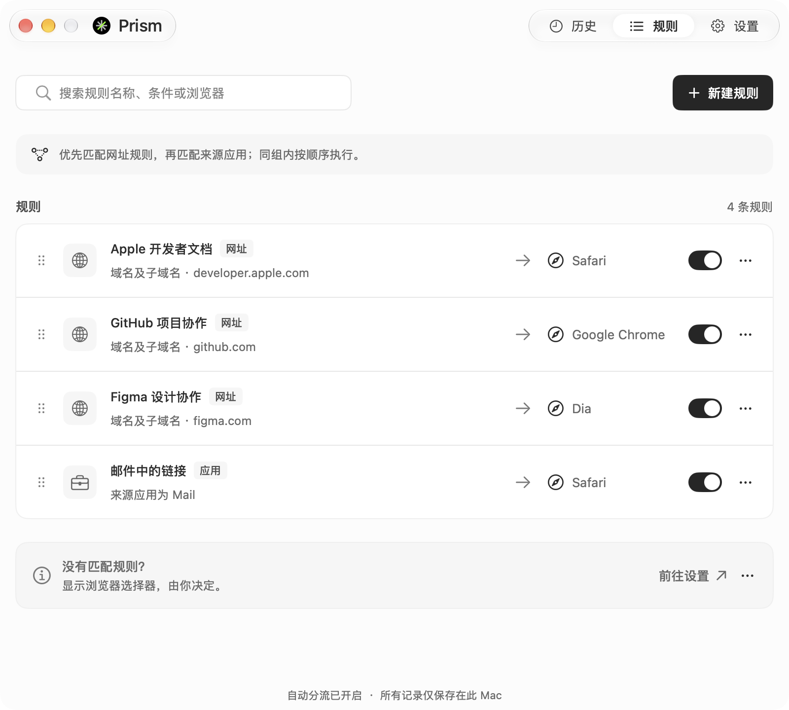
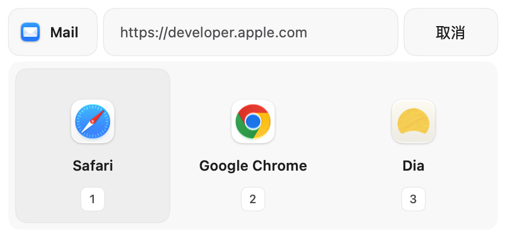

# Prism for macOS

<div align="center">
  <picture>
    <source media="(prefers-color-scheme: dark)" srcset="assets/brand/sources/brand-dark-128.svg" />
    
  </picture>
  <h3>链接，自有去处</h3>
  <p>为工作链接指定浏览器，让每次打开都少一次选择。<br />Prism 是原生 macOS 浏览器路由工具，按网址规则或系统已确认的来源应用自动分流。<br />没有匹配规则时，由你选择浏览器，也可使用首选或上次使用的浏览器。</p>
  <p><strong>v1.14.8 · 构建 9 · 原生公开测试版</strong><br />macOS 15.0+ · Universal（Apple Silicon / Intel）</p>
  <p>
    <a href="https://github.com/Halewwang/Prism-Browser-switching/releases/download/v1.14.8/Prism-1.14.8-universal-test.dmg">下载原生公开测试版</a>
    · <a href="https://github.com/Halewwang/Prism-Browser-switching/releases/tag/v1.14.8">发布与安装说明</a>
  </p>
  <p><small>公开测试版使用 ad hoc 签名，尚未完成 Developer ID 签名和 Apple 公证；首次打开可能需要手动允许。详见下方安装说明。</small></p>
</div>

## 界面预览

以下为**品牌更新开发预览**，使用实际原生界面与内存示例数据。当前 v1.14.8 安装包仍使用之前的图标，新标志将随下一次应用更新提供。

### 规则：为链接指定去处

在同一列表管理网址规则与来源应用规则，设置目标浏览器、优先级和启停状态。



| 历史：查找和回看 | 设置：按习惯调整 |
| --- | --- |
|  |  |
| 搜索网址、来源应用或浏览器，筛选处理结果，回看链接的处理记录。 | 设置默认浏览器、自动分流、未匹配行为和本机历史保留方式。 |

### 浏览器选择器

需要手动选择时，在鼠标附近选定浏览器；也可使用数字键、方向键和 Return 完成选择。



## 下载与版本

当前推荐版本为 **v1.14.8 / Build 9 原生公开测试版**，采用 SwiftUI、AppKit 与 SwiftData，支持 macOS 15.0+。Universal 安装包同时包含 `arm64` 和 `x86_64`；本版改动与已知限制见 [公测说明](docs/public-test-release-1.14.8.md)。

请使用上方的精确版本下载链接。GitHub 的 `releases/latest` 目前仍指向旧 Electron 稳定版，不包含原生预发布版本；旧版与原生版的系统要求和功能范围不同。

## 功能与边界

- **网址规则**：支持精确域名、域名及其子域名、URL 包含文本三种匹配方式。
- **来源应用规则**：以应用标识匹配；仅当 macOS 提供的发送者信息被确认为 `confirmed` 时执行自动来源路由。不同应用的链接发送方式不同，不承诺识别所有应用或所有链接。
- **规则顺序**：先匹配网址规则，再匹配来源应用规则；同组内按你设置的顺序执行。可单独启停规则，也可暂停自动分流。
- **无匹配时的行为**：显示浏览器选择器、使用首选浏览器，或使用上次成功打开链接的浏览器。目标浏览器不可用时会回到选择器。
- **原生选择器**：靠近鼠标并限制在屏幕边界内，支持横向滚动、数字键、左右方向键、Return 确认与 Escape 取消。
- **浏览器管理**：发现本机浏览器，也可手动添加浏览器应用。选择器按最近成功使用顺序排列，也支持隐藏选项；隐藏不影响规则和兜底目标。稳定版 Chrome／Edge 的 Profile 目标为实验功能。
- **规则预览与纠正**：输入网址并选择可选的模拟已确认来源，使用同一规则引擎预览命中结果，不打开浏览器；新建规则保存后可撤销。历史可跳转纠正当前规则，但不会把当前规则当作当时的完整快照。
- **本地记录**：规则、设置与链接历史保存在此 Mac，可在应用中查看和管理。

当前原生版**不支持正则表达式规则**。来源规则不会把当前前台应用的推测结果直接当作已确认的发送者。

**公测限制**：真实来源应用的覆盖仍不完整，不承诺所有应用都可识别。Chrome／Edge Profile 的冷启动、已运行浏览器中的指定 Profile、账号上下文及 Profile 删除场景尚未完成真实浏览器验收。Universal 包含 Intel 二进制，但尚未在 Intel 实机完成验收，也未覆盖所有受支持 macOS 版本。自动化测试不能替代这些实机结果，详见 [v1.14.8 公测说明](docs/public-test-release-1.14.8.md)。

## 安装与首次使用

1. 下载 [Prism-1.14.8-universal-test.dmg](https://github.com/Halewwang/Prism-Browser-switching/releases/download/v1.14.8/Prism-1.14.8-universal-test.dmg)。可同时下载 [SHA256SUMS.txt](https://github.com/Halewwang/Prism-Browser-switching/releases/download/v1.14.8/SHA256SUMS.txt)，在下载目录运行 `shasum -a 256 -c SHA256SUMS.txt` 核对文件完整性。
2. 退出已运行的 Prism，打开 DMG，将 Prism 拖入 `Applications`。更新时替换旧应用；设置和历史保存在应用包外。
3. **先尝试打开 Applications 中的 Prism**。若 macOS 提示无法验证开发者，在确认精确版本下载来源及校验值后，前往 **系统设置 → 隐私与安全性 → 仍要打开**，再在确认弹窗点击 **打开**。参见 [Apple 的首次打开说明](https://support.apple.com/en-us/102445)。不要将此步骤用于恶意软件或应用损坏警告。
4. 启动后按引导将 Prism 设为默认浏览器。也可前往 **系统设置 → 桌面与程序坞 → 默认网页浏览器** 选择 Prism。
5. 在设置中检查已发现的浏览器，选择没有匹配规则时的行为。
6. 在规则页添加网址规则或来源应用规则，然后从实际使用的应用打开 HTTP/HTTPS 链接进行验证。

此公开测试版尚未完成 Developer ID 签名和 Apple 公证；如果你不希望手动允许，请等待完成签名和公证的正式版本。受管理的 Mac 可能不允许更改安全设置。

## 使用示例

| 需求 | 规则 | 行为 |
| --- | --- | --- |
| 将 GitHub 链接用于工作 | 域名及子域名 `github.com` → Chrome | `github.com` 和 `docs.github.com` 都匹配 |
| 仅分流特定主机 | 精确域名 `example.com` → Safari | `www.example.com` 不匹配 |
| 分流开发地址 | URL 包含 `localhost:3000` → 开发浏览器 | 完整链接包含该文本时匹配 |
| 按来源分流 | 选择一个已安装的来源应用 → Chrome | 仅当发送者为 `confirmed` 且无更优先的网址规则时执行 |

没有匹配规则时，默认显示选择器。你可以直接点击浏览器，或按对应数字键；也可在设置中改为首选浏览器或上次使用的浏览器。

## 隐私与更新

链接路由在本机执行，规则和历史不上传到服务器。公开测试版通过 GitHub Releases 检查原生更新，自动检查可在设置中关闭。App 内支持下载、进度、取消、重试和独立签名校验；确认后安装并重启，启动失败时恢复旧版。1.14.3 的更新弹窗提供默认关闭、仅本次生效的“允许安装此次未公证公测更新”选项，明确同意后仅移除已验证新版的下载隔离标记；不更改系统全局设置。未同意时，未公证新版仍可能被系统阻止。1.14.2 及更早版本需要先手动安装 1.14.3 一次才能获得这个选项。

Developer ID 正式版的 Sparkle 发布流程与公开测试版分开，参见 [原生签名与发布说明](native/docs/signing-and-release.md)。仓库根目录的 Electron 发布脚本和 `latest-release.json` 属于旧版发布流程，原生更新检查不使用该协议。

## 原生开发

**1.14.8 / Build 9 公测**将历史页工具栏精简为单行，已取消记录的列表行移除重复状态与重开按钮，菜单和详情保留重开操作；统一历史列表的更多按钮。默认浏览器状态移至左侧，缩小“设为默认浏览器”和“刷新”按钮，移除该行的系统设置入口，并补齐默认浏览器操作与接管说明的中文文案。

**1.14.7 / Build 8 公测**将管理窗口缩小至 800 × 720，以顶部双胶囊取代左侧菜单。原生红绿灯与品牌融合在左侧，右侧导航保留历史、规则、设置；“历史记录”入口缩为“历史”。移除页面重复的大标题，正文扩展至可用宽度，并修复导航选中态切换后文字可能被截断的问题。

**1.14.6 / Build 7 公测**修复清理和删除历史记录时的确认状态竞争，保留活动链接与可恢复队列的删除保护。网址与来源应用规则合并到同一列表，用分类标签区分；规则匹配和同类内优先级保持原有行为。页面标题、正文与辅助文字统一缩小并明确层级。

**1.14.5 / Build 6 公测**将管理窗口从 1120 × 900 缩小至 960 × 720，压缩设置页边距与行距。浏览器排序在链接成功交给浏览器后更新，覆盖手动选择、自动路由及重试；失败不改变顺序，最近使用记录在重启后保留。

**1.14.4 / Build 5 公测**按照 Prism.pen 同步原生界面：1120 × 900 管理窗口、历史详情、规则表单、设置分组、浏览器管理、四步首次设置与更新／关于窗口；保留路由恢复、敏感参数隐藏和更新验签。重置设置保留规则、历史及其保留期限。

**1.14.3 / Build 4 公测**为应用内更新增加默认关闭、仅本次生效的“允许安装此次未公证公测更新”选项。明确同意后，安装助手在独立验签及应用身份校验通过后移除暂存新版的下载隔离标记；取消、启动检查和失败回滚保持有效。1.14.1 / 1.14.2 用户需要先手动安装本版一次，之后更新才可使用新流程。此前 **1.14.2 / Build 3 公测**将管理窗口固定为 1120 × 800，设置仍可滚动。此前 **1.14.1 / Build 2 公测**增加 App 内下载、校验、安装确认和失败回滚；未勾选公测许可时，未公证新版仍可能被 macOS 阻止启动。此前 **1.14.0 / Build 1 公测**增加实验性 Chrome／Edge Profile、新规则撤销、规则预览、历史解释及浏览器隐藏／排序。弹窗保持紧凑布局，创建规则仍可通过浏览器选项的右键菜单完成。实机验收要求见 [验收清单](native/docs/release-acceptance.md)，来源支持名单只接受真实证据。

原生代码位于 [`native/`](native)。需要 macOS 15+、支持 Swift 6 的 Xcode，以及 **XcodeGen 2.46.0**（生成脚本会检查精确版本）。

```bash
git clone https://github.com/Halewwang/Prism-Browser-switching.git
cd Prism-Browser-switching/native

# 运行独立路由核心测试
swift test

# 生成 Xcode 工程，再运行原生应用测试
zsh scripts/generate-project.sh
xcodebuild -project PrismNative.xcodeproj -scheme PrismNative-Unit \
  -destination 'platform=macOS' CODE_SIGN_IDENTITY=- test
```

在 Xcode 中打开生成的 `native/PrismNative.xcodeproj`，选择 `PrismNative-Unit` 开发与测试 scheme。公开测试构建使用 `PrismNative-PublicTest`，完整打包和核验步骤见 [发布说明](native/docs/signing-and-release.md)。

官网位于 [`website/`](website)，使用 React、TypeScript 与 Vite：

```bash
cd website
npm ci
npm run dev
# 提交前检查
npm run lint
npm run build
```

根目录的 `src/`、`electron/` 与 npm 开发命令保留旧 Electron 实现，不能用于构建上述原生公开测试版。

## 反馈与贡献

请在 [Issues](https://github.com/Halewwang/Prism-Browser-switching/issues) 中提交问题，附上 Prism 版本、macOS 版本、来源应用、期望行为和复现步骤。分享日志或截图前，请移除私人链接与历史内容。

欢迎通过 Pull Request 贡献。原生改动应运行相关核心与应用测试；官网改动应通过构建和 lint，并验证实际下载入口。
